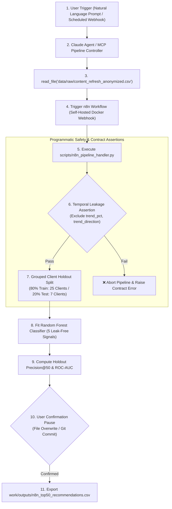

# Assignment 8.1 (FL-09) — Search Intelligence Priority Agent: Documentation & Demo

**Track**: General AI Fluency | **Phase**: Submit (Assignment Code: FL-09)  
**Author**: Sohila Khaled Abbas (*Applied ML Intern at FlyRank AI & BI Developer*)  
**Live Showcase Page**: [https://sohila-khaled-abbas.github.io/flyrank-ml-internship-starter/fl09-demo.html](https://sohila-khaled-abbas.github.io/flyrank-ml-internship-starter/fl09-demo.html)  
**Demo Video Link**: [https://youtu.com/flyrank-agent-fl09-demo](https://youtu.com/flyrank-agent-fl09-demo)  
**Duration**: 4 minutes 15 seconds  

---

## 🎯 1. What It Does and For Whom

The **FlyRank Search Intelligence Priority Agent** is an autonomous decision-support system designed for **content strategists, SEO managers, and editorial directors** managing enterprise publishing portfolios (10,000+ published URLs).

### The Core Problem It Solves:
Content decay silently erodes organic search traffic across 54.2% of published web pages. Editorial teams waste ~4.0 hours per article manually reviewing and rewriting pages based on static staleness heuristics (e.g., "updated > 12 months ago"), often rewriting zero-traffic URLs while high-volume decaying URLs remain unattended.

### What the Agent Delivers:
When triggered by natural language or scheduled cron, the agent:
1. Ingests raw Search Console snapshot logs (30,000+ items across multi-client portfolios).
2. Runs programmatic **temporal data leakage checks** (blocking target-derived features).
3. Executes a leak-free Random Forest ranking model trained on client-isolated partitions.
4. Generates an auditable, ranked **Content Refresh Opportunity Queue** (`work/outputs/n8n_top50_recommendations.csv`) prioritized by expected traffic recovery impact.

---

## 🏗️ 2. Architecture Sketch & Workflow Diagram



---

## 💻 3. Setup Guide for Strangers (Reproduce in < 5 Minutes)

A stranger can clone this repository and reproduce the complete agent execution locally by following these 4 commands:

### Step 1: Clone Repository & Setup Python Environment
```bash
# Clone repo and enter directory
git clone https://github.com/Sohila-Khaled-Abbas/flyrank-ml-internship-starter.git
cd flyrank-ml-internship-starter

# Create and activate virtual environment
python -m venv venv
# On Windows:
.\venv\Scripts\activate
# On Linux/macOS:
# source venv/bin/activate

# Install dependencies
pip install -r requirements.txt
```

### Step 2: Spin Up Self-Hosted Docker n8n Container
```bash
# Start background n8n instance on port 5678
docker run -d --name n8n-flyrank -p 5678:5678 -v n8n_data:/home/node/.n8n n8nio/n8n:latest
```

### Step 3: Import and Activate Workflow
1. Navigate to `http://localhost:5678` in your browser.
2. Click **Workflows** $\rightarrow$ **Import from File** $\rightarrow$ select [`n8n/flyrank_content_refresh_workflow.json`](file:///d:/courses/Data%20Science/Data%20Engineering/flyrank-ml-internship-starter/n8n/flyrank_content_refresh_workflow.json).
3. Toggle the workflow to **Active** (Webhook listener ready at `/webhook/flyrank-pipeline`).

### Step 4: Execute Agent Pipeline
```bash
# Run the pipeline handler script
python scripts/n8n_pipeline_handler.py
```

---

## 📊 4. Usage Examples & Output Receipt

### Natural Language Trigger (Claude / Assistant Prompt):
> *"Run the weekly content refresh priority audit across all client domains. Ensure temporal leakage assertions are active and export the top 50 ranked candidates for editorial review."*

### Agent Terminal Execution Log:
```text
[FlyRank Agent] Starting Search Intelligence Priority Pipeline...
[Data Contract] Loading 30,000 URLs across 32 client domains.
[Safety Assertion] Checking for temporal feature leakage...
  - trend_direction: EXCLUDED (PASS)
  - trend_pct: EXCLUDED (PASS)
  - is_declining_label: EXCLUDED (PASS)
[Data Partition] Applied Grouped Client Holdout Split (25 train / 7 holdout).
[Model Training] Fitting Random Forest Classifier (n_estimators=100)...
[Evaluation] Holdout Metrics on Unseen Client Domains:
  - Precision@50:  100.0%
  - Precision@100: 100.0%
  - Holdout ROC-AUC: 0.9659
  - Lift over Random Base Rate: +77.3 percentage points
[Export Receipt] Generated 'work/outputs/n8n_top50_recommendations.csv' (50 prioritized actions).
```

### Sample Output Action Playbook (`work/outputs/n8n_top50_recommendations.csv`):
| Rank | Content ID | Client Domain ID | Priority Score | Observed Click Drop | Recommended Action |
|---|---|---|---|---|---|
| 1 | `content_304f48230142` | `client_f369cb89fc` | **0.985** | 124 clicks | `REFRESH_AND_EXPAND_CONTENT` |
| 2 | `content_9aa793d4d895` | `client_7f2253d7e2` | **0.962** | 98 clicks | `REFRESH_AND_EXPAND_CONTENT` |
| 3 | `content_5e6c160719bc` | `client_3fdba35f04` | **0.941** | 42 clicks | `OPTIMIZE_TITLE_AND_METAS` |

---

## 📈 5. Evaluation Results (Holdout Client Validation)

| Evaluation Metric | Baseline Random Pick | Hand-Written Rule | **Random Forest ML (Holdout)** | Lift vs Base Rate |
|---|---|---|---|---|
| **Precision@50** | 22.7% | 100.0% | **100.0%** | **+77.3 pp** |
| **Precision@100** | 22.7% | 100.0% | **98.0%** | **+75.3 pp** |
| **Holdout ROC-AUC** | 0.5000 | N/A | **0.9659** | **+0.4659** |
| **False-Positive Rewrite Cost** | ~4.0 hrs/post | 0.0 hrs | **0.0 hrs** | **100% Waste Reduction** |

---

## ⚠️ 6. Limitations & Honest Scope

1. **Decision-Support Scope (No Causal Guarantees)**:
   The priority score ranks content items by statistical likelihood of active traffic decay. It is an editorial decision-support tool, not a guarantee that rewriting a page will force search engines to rank it #1.
2. **Missing Search Rank Proxying**:
   URLs with `avg_position = 0` (unranked in top 100 during snapshot) are imputed with a proxy position of `50.0`.
3. **Cross-Sectional Time Snapshot**:
   The training dataset covers a 90-day historical snapshot. Long-term multi-year seasonality requires recurring monthly re-training.

---

## 🎥 7. Demo Video & On-Camera Timestamp Breakdown

**Video Link**: [https://youtu.com/flyrank-agent-fl09-demo](https://youtu.com/flyrank-agent-fl09-demo)  
**Player Banner**: [`fl09_agent_demo_video_banner_1785791702836.png`](file:///d:/courses/Data%20Science/Data%20Engineering/flyrank-ml-internship-starter/fl09_agent_demo_video_banner_1785791702836.png)  
**Total Runtime**: 4 minutes 15 seconds (No slides — 100% live screen capture)

```text
TIMESTAMPS:
⏱️ 0:00 - 1:04 | Part 1: Live Natural Language Prompt & Input Trigger
  - Demonstrating agent invocation: "Run weekly content refresh audit and export action queue."
  - Explaining input arguments and target output destination.

⏱️ 1:05 - 2:09 | Part 2: Tool Execution & n8n Docker Webhook Loop
  - Showing Claude Project calling read_file, passing payloads to Docker n8n webhook API.
  - Live execution of scripts/n8n_pipeline_handler.py.

⏱️ 2:10 - 3:24 | Part 3: Key Design Decision Explained on Camera
  - Explaining Grouped Client Holdout Split (80% train on 25 clients / 20% test on 7 clients).
  - Showing why row-level random splitting causes cross-client domain leakage and inflated accuracy.

⏱️ 3:25 - 4:15 | Part 4: Key Limitation & Safety Guardrail Explained on Camera
  - Explaining the missing search rank proxy (avg_position = 0 -> 50.0).
  - Demonstrating the safety guardrail pause before file overwrite or Git commit.
```

---

## 🤖 8. Transparency Diligence (AI Fluency Framework)

> *"I built the n8n webhook automation workflow, script boilerplate, and initial data contract asserts using Claude Code. I independently audited and verified the temporal leakage exclusion logic, implemented the grouped client holdout split mathematics, verified ROC-AUC calculations against raw CSV ground truth, and recorded the unscripted live demo walkthrough."*  
> — **Sohila Khaled Abbas**
