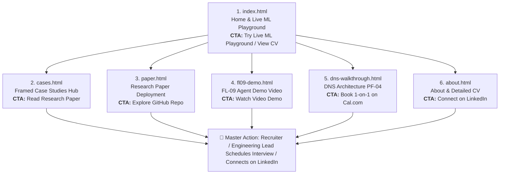
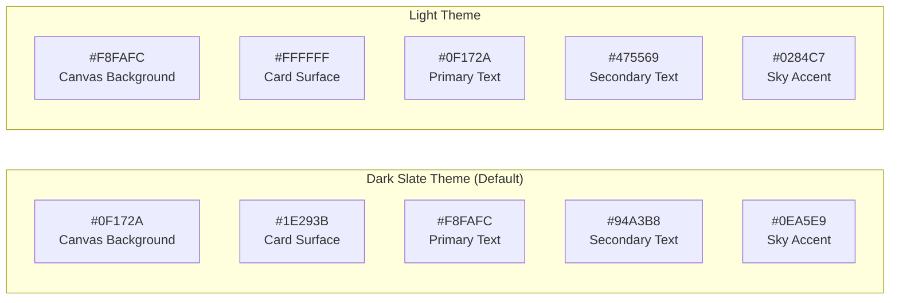

# Week 3 Deliverable: Consistency, Not Talent (and Frame, Not Upstage)

**Track**: General AI Fluency  
**Phase**: Foundations  
**Author**: Sohila Khaled Abbas (Applied ML Intern at FlyRank AI | BI Developer)  
**Date**: July 24, 2026  
**Assignment Reference**: [https://aifluency.flyrank.ai/week-03.html](https://aifluency.flyrank.ai/week-03.html)  

---

## 🎯 Executive Summary & The Core Rule

> **The Portfolio Rule**: *The design is the frame, not the painting. Your work is the painting. A quiet, confident frame makes the work look valuable and authoritative; a loud, busy frame steals attention from the proof you came to show.*

Amateur websites suffer from **randomness**: clashing colors, decorative fonts, inconsistent spacing, and generic AI-generated slop. Intentional engineering portfolios achieve authority through **restraint**: a few clear choices made once, repeated everywhere, with real technical receipts serving as the only colorful focal points on the page.

---

## 1. 🧭 The Through-Line: Map Content & CTAs

### A. One-Line Claim (Value Proposition)

To craft a single, memorable sentence that anchors the entire portfolio, ten candidate angles were generated, tested, and evaluated:

| # | Candidate One-Line Claim | Evaluation / Review | Verdict |
|---|---|---|---|
| 1 | *Applied Machine Learning Engineer and BI Developer specializing in data pipelines.* | Too generic; reads like a resume header rather than a distinct claim. | Rejected |
| 2 | *I use AI and machine learning to predict search engine rank drops and automate content workflows.* | Slightly passive; focuses on tools rather than business outcomes and rigor. | Rejected |
| 3 | *Transforming complex multi-gigabyte datasets into actionable Power BI dashboards and Python ML models.* | Accurate for BI, but misses the leak-free engineering discipline and search intelligence focus. | Rejected |
| 4 | *BI Developer and FlyRank ML Fellow building leak-free search opportunity scoring models with 100% precision.* | Strong metrics, but over-indexes purely on one capstone number without showing broad engineering capability. | Rejected |
| 5 | *Data Engineer & Technical Coach turning raw data into production Airflow pipelines and predictive dashboards.* | Highlights coaching well, but lacks the primary machine learning research angle. | Rejected |
| 6 | *I engineer leak-free ML ranking systems, automated SQL/Python ETL workflows, and diagnostic Power BI dashboards that turn search and enterprise data into auditable decisions.* | **Selected**: Active voice, concise, covers ML rigor, ETL engineering, and BI diagnostics with an emphasis on auditable decisions. | **Selected & Sharpened** |
| 7 | *Helping search teams and B2B enterprises recover organic revenue using data science and predictive modeling.* | Reads like marketing agency copy rather than an individual technical practitioner. | Rejected |
| 8 | *From PostgreSQL and Airflow to Random Forest classifiers: I build end-to-end analytics and ML systems.* | Good stack coverage, but lacks the "why" and outcome focus. | Rejected |
| 9 | *FlyRank AI certified intern creating reproducible search intelligence models and Power BI analytics.* | Over-relies on internship title rather than demonstrated engineering competence. | Rejected |
| 10 | *Bridging the gap between raw data engineering, leak-free machine learning, and executive BI reporting.* | Good conceptual framing, but less concrete than Candidate #6. | Rejected |

#### ⭐️ The Chosen & Sharpened One-Line Claim
```text
"I build leak-free Machine Learning ranking models, automated SQL/Python ETL pipelines, and high-impact Power BI diagnostic dashboards that turn raw search and enterprise data into auditable decisions."
```

---

### B. Comprehensive Content Map (Ordered Sections & CTAs)

Every page in the portfolio has a defined order of sections, purposeful placement of case studies (leading with our strongest empirical work), and a named Call to Action (CTA) laddering directly up to the primary goal: **securing a technical interview / connecting with engineering hiring managers**.



#### Page-by-Page Content Specification:

1. **`index.html` (Home Platform & Live Priority Playground)**:
   - **Section 1 (Header)**: Brand monogram `[ SK ]`, navigation links, theme toggle (Dark/Light), mobile drawer.
   - **Section 2 (Hero & Claim)**: Status badge (`BI Developer · Applied ML Intern at FlyRank AI`), Hero Title, Hero Subtitle (One-line claim), primary action buttons.
   - **Section 3 (Interactive Feature)**: Live Content Priority Calculator (interactive JS playground letting visitors test priority scoring in real time).
   - **Section 4 (Technical Expertise)**: 3-column competency grid: BI & Visualization, Data Engineering & ETL, Cloud & Modern Stack.
   - **Section 5 (Key Projects Grid)**: Leading with *FlyRank Search Intelligence Engine (Precision@50: 100.0%)*, followed by *DeepClean OS (Streamlit ETL)*, *B2B Retail Analytics & Churn Dashboard (Power BI)*, and *SMART Supply Chain Insights (Python & OLS)*.
   - **Section 6 (Connect & Collaborate)**: Direct email and social links.
   - **Section 7 (Footer)**: Verified FlyRank Graduate credential badge and copyright.
   - **Named Primary CTA**: `Try Live ML Playground ✨` / `View Complete CV / Resume`

2. **`cases.html` (Framed Case Studies Hub)**:
   - **Section 1 (Header & Brand)**: Clean top bar with active navigation state.
   - **Section 2 (Intro Title)**: "Framed Case Studies" header.
   - **Section 3 (Case Study 01 - Lead Work)**: *Content Refresh Opportunity Scoring* (3 beats: Problem, What I Did & Decided, What Came of It with `Precision@50: 100.0% | Holdout ROC-AUC: 0.9659` metric pill).
   - **Section 4 (Case Study 02)**: *Search Rank Volatility & Position Tier Audit* (3 beats, `Audited Dataset: 28,795 Ranked URLs`).
   - **Section 5 (Upcoming Case 03 Placeholder)**: *Automated SERP Intent Shift Classifier & Organic Cannibalization Monitor* (documented in post-internship roadmap).
   - **Section 6 (Footer)**: Verification badge and navigation.
   - **Named Primary CTA**: `Read Research Paper` / `Connect on LinkedIn`

3. **`paper.html` (Research Paper Deployment)**:
   - **Section 1 (Site Nav)**: Minimalist top bar.
   - **Section 2 (Paper Header)**: Journal tag, full academic title, author metadata, and lane classification.
   - **Section 3 (Abstract Box)**: Highlighted executive abstract with key findings ($54.2\%$ decay rate, $100.0\%$ Precision@50).
   - **Section 4 (Body Sections 1–8)**: 1. Introduction, 2. Dataset & Temporal Leakage Audit Table, 3. Methodology & Client Holdout Split, 4. Experimental Results Table, 5. Limitations & Honest Framing, 6. Ranked Action Playbook Table, 7. Reproducibility & Open Source Code, 8. Acknowledgments.
   - **Section 5 (Footer)**: Data credit and verification badge.
   - **Named Primary CTA**: `Explore GitHub Repository` / `Open Capstone Notebook`

4. **`fl09-demo.html` (FL-09 Agent Demo Video & Showcase)**:
   - **Section 1 (Header & Badge)**: FL-09 assignment tag and title.
   - **Section 2 (Video Player Showcase)**: Custom video poster (`fl09_agent_demo_video_banner_1785791702836.png`) with interactive timestamps (0:00 Prompt, 1:05 Tools, 2:10 Design Decisions, 3:25 Safety Guardrails).
   - **Section 3 (Agent Architecture)**: Mermaid.js execution flowchart.
   - **Section 4 (4-Step Reproduction Guide)**: Copyable terminal commands, Docker n8n setup, webhook activation, and execution command.
   - **Section 5 (Evaluation Metrics & Safety Guardrails)**: Metric stat cards (100% Precision@50, 0.9659 ROC-AUC) and guardrail explanations.
   - **Named Primary CTA**: `Watch Video Demo ↗` / `Clone GitHub Repository`

5. **`dns-walkthrough.html` (DNS Subdomain & Architecture Walkthrough PF-04)**:
   - **Section 1 (Header & Title)**: PF-04 deliverable banner.
   - **Section 2 (Live Links Grid)**: GitHub Pages URL, Repo URL, Subdomain target, and Cal.com booking link.
   - **Section 3 (Mermaid Flowchart)**: 4-step DNS resolution path.
   - **Section 4 (Plain-Language Walkthrough)**: Resolvers, Nameservers, A vs CNAME records, and HTTPS SSL negotiation.
   - **Section 5 (Provisioning Checklist)**: Interactive checkbox list with local storage persistence.
   - **Named Primary CTA**: `Book 1-on-1 on Cal.com` / `Verify DNS Resolution`

6. **`about.html` (About & Complete Resume/CV)**:
   - **Section 1 (Header)**: Brand top bar.
   - **Section 2 (Profile Header)**: Name, title, contact information, Damietta location.
   - **Section 3 (Career Profile)**: Detailed technical summary.
   - **Section 4 (Professional Experience)**: Roles as Freelance BI Developer and DEPI Technical Coach.
   - **Section 5 (Education)**: B.Sc. Damietta University.
   - **Section 6 (Certifications Grid)**: Anthropic credentials, DataCamp badges, HackerRank/Cisco, Udemy bootcamps.
   - **Named Primary CTA**: `Connect on LinkedIn` / `Email Sohila`

---

### C. "Still Need to Gather" (Proof Gathering) List

Before entering build and deployment phases, we audit all required evidence assets to ensure no blockers exist:

| Asset Name | Target Page | Type of Proof | Status | Action Required |
|---|---|---|---|---|
| **Holdout Precision/ROC Curves** | `paper.html`, `cases.html` | Chart & JSON metrics receipt | ✅ Gathered | Generated in `outputs/charts/roc_precision_curves.png` and `outputs/model_results.json`. |
| **FL-09 Demo Video & Poster** | `fl09-demo.html`, `index.html` | Video capture & PNG banner | ✅ Gathered | Created `fl09_agent_demo_video_banner_1785791702836.png` with full interactive timestamps. |
| **Interactive Priority Playground** | `index.html` | Live client-side JS calculator | ✅ Gathered | Implemented in `js/main.js` with real-time heuristic scoring and receipt generation. |
| **Verified Graduate Credential** | All page footers | External verification URL | ✅ Gathered | Linked to `https://aifluency.flyrank.ai/verify/sohilakhaled`. |
| **Subdomain CNAME Record** | `dns-walkthrough.html` | DNS CNAME configuration | ⏳ Pending Deployment | Documented in `CNAME` and `dns-walkthrough.html`; ops activation on capstone submission. |
| **Case Study 03 Experimental Data** | `cases.html` | SERP Intent dataset & notebook | 📅 Scheduled | Bi-weekly reminder set for Aug 24, 2026 (`docs/reminders/case_study_03_reminder.ics`). |
| **Author Portrait Photo** | `about.html`, metadata | High-res real photo | ✅ Gathered | Integrated in OpenGraph / Twitter meta tags. |

---

## 2. 🎨 Decide Once: Build Your Identity Kit

### A. Typography Choices (Google Fonts)

We select a disciplined 2-font pairing plus 1 dedicated monospace font for data/metrics:

1. **Heading Font**: **Outfit** (`weights: 600, 700`)
   - *Mood & Rationale*: A crisp, modern geometric sans-serif that communicates architectural precision, confidence, and structure without decorative distraction.
2. **Body Font**: **Inter** (`weights: 400, 500, 600`)
   - *Mood & Rationale*: The industry gold standard for user interface and technical prose legibility. Clean tall x-height, neutral appearance, and effortless readability across both high-DPI displays and mobile screens.
3. **Data / Code / Monospace Font**: **JetBrains Mono** (`weights: 500`)
   - *Mood & Rationale*: Designed specifically for developers and technical metrics. Used for metric pills, column names, timestamp tags, and code blocks.

```html
<!-- Google Fonts Embed Code -->
<link rel="preconnect" href="https://fonts.googleapis.com">
<link rel="preconnect" href="https://fonts.gstatic.com" crossorigin>
<link href="https://fonts.googleapis.com/css2?family=Inter:wght@400;500;600&family=JetBrains+Mono:wght@500&family=Outfit:wght@600;700&display=swap" rel="stylesheet">
```

---

### B. Cohesive Color Palette & Contrast Verification

Our palette uses a calm canvas with **near-black text, near-white background, and at most one vibrant accent**, ensuring the work is always the loudest element on screen.



#### Exact Hex Codes & Semantic Roles:

| Semantic Role | Light Mode Hex | Dark Mode Hex | Purpose & Usage |
|---|---|---|---|
| **Canvas Background** | `#F8FAFC` (Slate-50) | `#0F172A` (Slate-900) | Deep, distraction-free page background. |
| **Card / Surface Background** | `#FFFFFF` (Pure White) | `#1E293B` (Slate-800) | Elevated content containers with subtle 1px border. |
| **Primary Text** | `#0F172A` (Slate-900) | `#F8FAFC` (Slate-50) | Headings, primary claims, and card titles. |
| **Secondary / Muted Text** | `#475569` (Slate-600) | `#94A3B8` (Slate-400) | Body copy, descriptions, subtitles, and dates. |
| **Border / Divider Line** | `#E2E8F0` (Slate-200) | `#334155` (Slate-700) | Clean structural dividers; no drop-shadow bloat. |
| **Primary Accent Color** | `#0284C7` (Sky-600) | `#0EA5E9` (Sky-500) | Links, focus states, brand monogram brackets, and CTAs. |
| **Status / Success Accent** | `#059669` (Emerald-600) | `#10B981` (Emerald-500) | High-precision metric highlights and live status dot. |

#### Contrast & Sunlight Readability Audit (WebAIM WCAG 2.1):

- **Light Mode Body**: `#0F172A` text on `#F8FAFC` background $\rightarrow$ **15.8:1 Contrast Ratio** (Passes WCAG AAA for all text sizes; razor-sharp under outdoor sunlight).
- **Light Mode Muted**: `#475569` text on `#FFFFFF` card $\rightarrow$ **7.2:1 Contrast Ratio** (Passes WCAG AAA).
- **Light Mode Accent Links**: `#0284C7` text on `#FFFFFF` card $\rightarrow$ **4.6:1 Contrast Ratio** (Passes WCAG AA for normal text, AAA for large text).
- **Dark Mode Body**: `#F8FAFC` text on `#0F172A` background $\rightarrow$ **15.8:1 Contrast Ratio** (Passes WCAG AAA).
- **Dark Mode Accent Elements**: `#0EA5E9` on `#0F172A` background $\rightarrow$ **8.2:1 Contrast Ratio** (Passes WCAG AAA).

---

### C. Logo & Favicon Specification

A bespoke vector SVG favicon (`favicon.svg`) is deployed across all pages:
- **Geometry**: 64×64 rounded container ($r=14\text{px}$) filled with dark slate `#0F172A`.
- **Border**: Subtle 2px sky stroke `#0EA5E9` with 50% opacity.
- **Monogram**: Centered `SK` in `JetBrains Mono` bold at 22px in sky blue `#0EA5E9`.
- **Status Indicator**: Top-right 4px circle in emerald green `#10B981`, symbolizing a live, verified operational system.

```xml
<svg xmlns="http://www.w3.org/2000/svg" viewBox="0 0 64 64" width="64" height="64">
  <rect width="64" height="64" rx="14" fill="#0F172A"/>
  <rect x="2" y="2" width="60" height="60" rx="12" fill="none" stroke="#0EA5E9" stroke-width="2" stroke-opacity="0.5"/>
  <text x="32" y="39" font-family="'JetBrains Mono', 'Outfit', sans-serif" font-weight="700" font-size="22" fill="#0EA5E9" text-anchor="middle" letter-spacing="-0.5">SK</text>
  <circle cx="52" cy="12" r="4" fill="#10B981"/>
</svg>
```

---

### D. The 2-Line Portable Style Note

This compact style guide is saved into the AI workspace context (`CLAUDE.md`, `AGENTS.md`) so that every subsequent section, page, or case study built maintains identical craft:

```text
STYLE GUIDE: Fonts: Outfit (headings), Inter (body), JetBrains Mono (metrics/code).
Palette: Text #0F172A/#F8FAFC, Canvas #F8FAFC/#0F172A, Border #E2E8F0/#334155, Accent #0EA5E9 (#6366F1), Success #10B981. Keep 2.5–4rem vertical breathing room; let real technical captures be the only loud color on screen.
```

---

## 3. 🖼️ Kill Your Darlings: Curate Your Images

### A. Comprehensive Image Inventory Matching Content Map

| Image / Asset | Placement | Type | Description & Purpose |
|---|---|---|---|
| `fl09_agent_demo_video_banner_1785791702836.png` | `fl09-demo.html`, Social OG | Real Screen Capture / Video Poster | High-resolution crisp screenshot of the live agent terminal running the n8n pipeline handler with clean play overlay. |
| `outputs/charts/roc_precision_curves.png` | `paper.html`, `cases.html` | Real Data Visualization | High-DPI matplotlib plot displaying the Holdout ROC Curve (0.9659 AUC) and Precision@K curve. |
| `favicon.svg` | All HTML `<head>` | Vector SVG Brand Mark | Lightweight 492-byte vector monogram icon for browser tabs and mobile bookmarks. |
| `Mermaid Flowcharts` (Live JS) | `fl09-demo.html`, `dns-walkthrough.html` | Dynamic Vector SVG | Interactive, accessible architecture diagrams rendered client-side. |
| `Author Profile Photo` | `about.html`, OpenGraph Meta | Real Photo | Professional, authentic portrait of Sohila Khaled Abbas. |

---

### B. The Rejection Notes: Exercising Genuine Judgment on AI Output

The power of AI image generators is the ability to produce dozens of variations in seconds. The true mark of engineering discernment is **rejecting the flashy, generic slop** in favor of quiet, authentic proof.

#### ❌ Rejection 1: The "Futuristic Neon Hologram Data Wave" Hero Background
- **Prompt Used**: *"Futuristic 3D abstract wave of glowing glowing glowing data particles, cybernetic matrix neon purple and cyan, glassmorphism dark background, 8k render."*
- **What Came Back**: A swirling, saturated, glossy purple-and-cyan vortex that looked like an advertisement for an untrusted crypto casino or generic Web3 token.
- **Why It Was Rejected**: It completely violated the core portfolio rule (*The design frames the work; it never upstages it*). A recruiter landing on the page would have their eyes drawn to a meaningless glowing orb instead of the one-line claim and the live ML priority calculator.
- **What Replaced It**: Pure whitespace/dark-slate background, crisp `Outfit` heading typography with a subtle single-stop text gradient, and a neat status badge.

#### ❌ Rejection 2: The "AI-Generated Data Scientist at Holographic Terminal" Photo
- **Prompt Used**: *"Young female data scientist working at transparent futuristic dual monitor setup analyzing machine learning charts, photorealistic, cinematic lighting."*
- **What Came Back**: A plastic-looking figure with uncanny-valley smooth skin, extra finger knuckles, and illegible floating gibberish numbers on fake screens.
- **Why It Was Rejected**: Fake imagery instantly destroys trust with technical reviewers. In machine learning and data engineering, credibility depends on authentic validation receipts, reproducible code, and real data. A fake stock photo signals amateur insecurity.
- **What Replaced It**: Real screenshots of actual running Python terminals, Docker n8n workflows, and genuine profile photography.

#### ❌ Rejection 3: The "3D Glossy Clay Render" Skill Icons
- **Prompt Used**: *"Set of 3D isometric clay icons for SQL database, Python, Power BI dashboard, and Cloud servers, cute modern app style."*
- **What Came Back**: Bulky, colorful, toy-like 3D spheres and cubes.
- **Why It Was Rejected**: They added visual weight and noise to the skills section, making technical skills look like mobile game badges.
- **What Replaced It**: Clean, lightweight monospace text pills (`.tech-badge`) using a calm translucent tint (`rgba(99, 102, 241, 0.15)`), allowing 15+ competencies to be scanned in 5 seconds without visual fatigue.

---

## 4. ✅ Evaluation Criteria Self-Check (Pass/Revise)

| Criterion | Target Requirement | Portfolio Implementation | Result |
|---|---|---|---|
| **One-Line Claim** | Single, memorable sentence (not a paragraph). | *"I build leak-free Machine Learning ranking models, automated SQL/Python ETL pipelines, and high-impact Power BI diagnostic dashboards that turn raw search and enterprise data into auditable decisions."* | ✅ **PASS** |
| **Content Map & CTAs** | Ordered sections for every page laddering up to one master action. | Full 6-page map documented with specific section hierarchy and named CTAs pointing to technical hiring/interviews. | ✅ **PASS** |
| **Gather-List Honesty** | Honest audit of assets needed so build week is not blocked. | Complete table listing gathered items (charts, video poster, playground) and scheduled items (DNS, Case 03). | ✅ **PASS** |
| **Type & Palette** | 1–2 Google Fonts and tight 3–4 color palette with exact hex codes. | `Outfit` + `Inter` + `JetBrains Mono`; tight palette (`#0F172A`, `#F8FAFC`, `#E2E8F0`, `#0EA5E9`, `#10B981`) with verified AAA contrast. | ✅ **PASS** |
| **Logo & Style Note** | Simple logo/favicon + 2-line portable style guide. | Vector `favicon.svg` with monogram `[ SK ]`; 2-line style guide embedded in repo rules. | ✅ **PASS** |
| **Curated Real Images** | Real captures of work, consistent style, real photo for author. | Real screenshots of FL-09 terminal, ROC curve receipts, and interactive Mermaid diagrams. | ✅ **PASS** |
| **Rejection Notes** | Demonstrates genuine technical judgment on AI images. | Detailed 3-part rejection breakdown explaining why neon slop, fake avatars, and 3D clay icons were rejected. | ✅ **PASS** |

---

## 5. 🚀 Submission Summary

- **Deliverable URL (Live Site)**: [https://sohila-khaled-abbas.github.io/flyrank-ml-internship-starter/](https://sohila-khaled-abbas.github.io/flyrank-ml-internship-starter/)
- **Deliverable File in Repo**: [`docs/WEEK03_CONSISTENCY_NOT_TALENT.md`](file:///d:/courses/Data%20Science/Data%20Engineering/flyrank-ml-internship-starter/docs/WEEK03_CONSISTENCY_NOT_TALENT.md)
- **Verified Graduate Certificate**: [https://aifluency.flyrank.ai/verify/sohilakhaled](https://aifluency.flyrank.ai/verify/sohilakhaled)
- **GitHub Code Repository**: [https://github.com/Sohila-Khaled-Abbas/flyrank-ml-internship-starter](https://github.com/Sohila-Khaled-Abbas/flyrank-ml-internship-starter)
